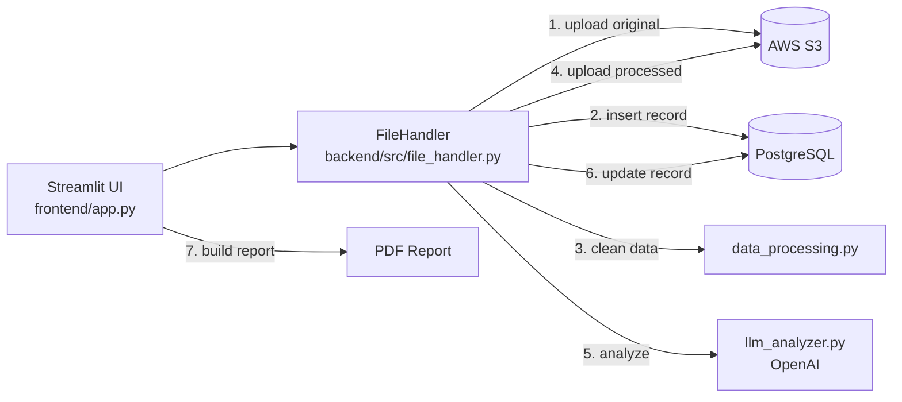

# Analytics Autopilot

An automated data analysis platform. Upload a CSV, and Analytics Autopilot cleans it, stores the original and processed versions in AWS S3, tracks every file in PostgreSQL, and uses an LLM to generate column descriptions, visualization code, and plain-English insights — all downloadable as a PDF report.
---

## Features

- **CSV upload & preview** through a Streamlit web interface
- **Automated data cleaning**
  - Removes duplicate rows and duplicate columns
  - Handles missing values by threshold:
    | Missing % | Numeric columns | Categorical columns |
    |---|---|---|
    | 0–10% | Fill with median | Fill with mode |
    | 10–50% | Interpolate, then median | Fill with `"Unknown"` |
    | > 50% | Drop column | Drop column |
- **Cloud storage** — original and processed files uploaded to S3 with timestamped keys
- **Processing history** — each file's lifecycle (uploaded → processing → completed/failed) recorded in PostgreSQL
- **AI analysis** — OpenAI generates column descriptions, 2–4 visualization code snippets, and an insights summary
- **PDF report** generation with ReportLab

---

## Architecture



**Workflow:** `FileHandler.complete_workflow()` runs two phases:

1. **Upload** — reads the file's dimensions, uploads it to `original/` in S3, and inserts a row into `file_uploads`.
2. **Process** — sets status to `processing`, runs the cleaning pipeline, uploads the result to `processed/` in S3, runs the LLM analysis, and updates the database row with the processed stats.

If the LLM step fails, the workflow still completes and the UI reports the LLM error.

---

## Project Structure

```
Analytics-Autopilot/
├── frontend/
│   ├── app.py                  # Streamlit UI + PDF report generation
│   └── requirements.txt
├── backend/
│   ├── requirements.txt        # Main dependency list (use this one)
│   ├── src/
│   │   ├── file_handler.py     # Orchestrates upload → process → analyze
│   │   ├── data_processing.py  # Cleaning pipeline
│   │   └── llm_analyzer.py     # OpenAI prompt, call, and response parsing
│   └── tests/
├── cloud/
│   ├── S3/uploader.py          # S3 upload, list, delete, presigned URLs
│   └── tests/
└── database/
    ├── connection.py           # Connection helper + table inspection
    ├── setup_database.py       # Creates tables from SQL
    ├── update_file_details.py  # CRUD operations for file_uploads
    ├── tables/file_storage.sql # Schema
    └── tests/
```

---

## Prerequisites

- **Python 3.11** — the pinned `numpy==1.24.3` and `pandas==2.1.4` do not install on Python 3.12+
- **PostgreSQL** database (local or hosted, e.g. AWS RDS)
- **AWS S3 bucket** and an IAM user with `s3:PutObject`, `s3:GetObject`, `s3:ListBucket`, and `s3:DeleteObject`
- **OpenAI API key**

---

## Setup

### 1. Clone and create a virtual environment

```bash
git clone <repo-url>
cd Analytics-Autopilot
python3.11 -m venv .venv
source .venv/bin/activate        # Windows: .venv\Scripts\activate
```

### 2. Install dependencies

```bash
pip install -r backend/requirements.txt
```

> Install from `backend/requirements.txt` only. `frontend/requirements.txt` pins `openai==1.3.0`, which is incompatible with the `openai==0.28` API the code uses.

### 3. Configure environment variables

Create a `.env` file in the project root:

```env
# OpenAI
OPENAI_API_KEY=sk-...

# AWS S3
AWS_ACCESS_KEY_ID=...
AWS_SECRET_ACCESS_KEY=...
AWS_REGION=us-east-1
AWS_S3_BUCKET_NAME=your-bucket-name

# PostgreSQL
DB_HOST=localhost
DB_PORT=5432
DB_NAME=postgres
DB_USER=postgres
DB_PASSWORD=...
```

> Keep `DB_NAME=postgres` for now: `setup_database.py` and `connection.py` always connect to the `postgres` database, while the app uses `DB_NAME`. Using the same value ensures the app finds the table.

### 4. Create the database table

The script uses a relative path, so run it from inside `database/`:

```bash
cd database
python setup_database.py
cd ..
```

Verify with:

```bash
python database/connection.py
```

### 5. Run the app

From the project root:

```bash
streamlit run frontend/app.py
```

Open http://localhost:8501, upload a CSV, and click **Process Data**.

---

## Database Schema

Table `file_uploads` (see [`database/tables/file_storage.sql`](database/tables/file_storage.sql)):

| Group | Columns |
|---|---|
| Identity | `id`, `original_filename`, `stored_filename`, `file_size`, `file_type` |
| Upload | `upload_datetime`, `upload_status`, `original_rows`, `original_columns`, `original_shape`, `s3_original_key` |
| Processing | `is_processed`, `processing_status` (`pending` / `processing` / `completed` / `failed`), `processing_datetime` |
| Results | `processed_filename`, `processed_rows`, `processed_columns`, `processed_shape`, `rows_removed`, `columns_removed`, `s3_processed_key` |
| Audit | `created_at`, `updated_at` |

S3 key format:

```
original/<name>_<YYYYMMDD_HHMMSS>.csv
processed/<name>_processed_<YYYYMMDD_HHMMSS>.csv
```

---

## Tests

The tests are integration scripts that call the real S3 bucket, database, and OpenAI API, so a configured `.env` is required. Run them from the project root:

```bash
python -m cloud.tests.test_uploader          # S3 connection, key format, bucket listing
python backend/tests/test_llm_analysis.py    # OpenAI analysis on a small sample dataset
python backend/tests/test_data_processing.py # needs backend/src/test_data.csv
python backend/tests/test_file_handler.py    # full workflow; needs backend/src/test_data.csv
```

`test_data.csv` is not committed (`*.csv` is git-ignored) — add your own sample file at `backend/src/test_data.csv`.

---

## Tech Stack

Python · Streamlit · pandas · NumPy · OpenAI · AWS S3 (boto3) · PostgreSQL (psycopg2) · ReportLab
